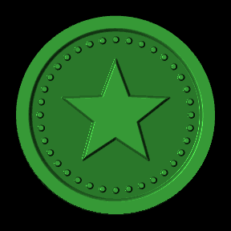
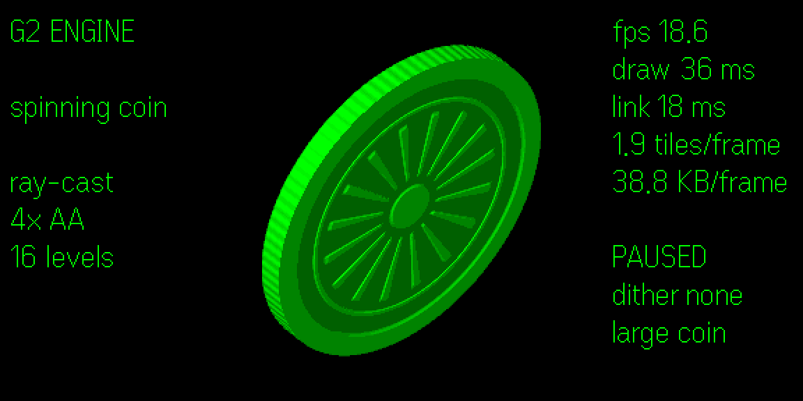

# g2-engine



g2-engine is a software raster engine for the [Even Realities G2](https://www.evenrealities.com/) smart glasses.
It draws into a 576×288 framebuffer in TypeScript, reduces each frame to the display's 16 brightness levels, and sends the glasses only the image tiles whose pixels changed.

> **Status: early prototype.** Everything in this repository runs in the official Even Hub simulator (0.9.5).
> It has not run on physical glasses yet, so frame rate and latency over Bluetooth are still unknown.

This is an independent project. It is not affiliated with or endorsed by Even Realities.

## Why draw pixels yourself

G2 apps show text through native text containers.
These give you no control over font size, family or weight, so you cannot set your own typography, line breaking for Japanese, or anything animated.
Image containers accept arbitrary pixels.
The engine renders into them, which gives the app full control over every pixel.
Native text stays available for regions that change often or matter less, because a text update costs far fewer bytes than an image update.

## What works today

- `Surface`, a floating-point framebuffer that runs a per-pixel shader function with optional supersampling.
- `quantize`, which maps intensity to levels 0..15 with optional gamma correction and a 4×4 Bayer dither. The dither pattern is fixed to screen coordinates, so neighbouring tiles line up.
- `encodeGrayPng`, a PNG encoder in plain TypeScript. It uses no canvas, so Node and the Even Hub WebView produce identical bytes.
- `Engine`, which tracks what each tile on the glasses currently shows and sends a tile only when its 16-level pixels differ. A paused animation sends 0 bytes.
- `FrameLoop`, an animation loop that drops stale frames on a slow link instead of queueing them, so the glasses always get the newest frame.
- An Even Hub adapter that maps tiles to image containers and sends one bridge call at a time, so updates never overlap and arrive in order.
- A spinning-coin demo that uses all of the above. On the glasses it runs at about 1.5 to 2 fps; see [Measured on glasses](docs/g2-platform.md#measured-on-glasses).
- A link probe (`demos/link-probe`) that times image and text updates on real glasses.

Planned next:

- cheaper frames: fewer gray levels, flat areas and smaller moving regions, measured with the link probe;
- text layout with Japanese line-breaking rules;
- an offline compiler from TTF/OTF fonts to 16-level bitmap fonts;
- choosing native text or raster per region, for battery and latency.

## Quick start

You need Node.js 22.18 or newer.

```sh
git clone https://github.com/Jadoking/g2-engine.git
cd g2-engine
npm install
npm run check   # type check and unit tests
npm run dev     # serves the coin demo on http://127.0.0.1:47846
```

Install the Even Hub simulator (`@evenrealities/evenhub-simulator` on npm) and point it at the dev server:

```sh
evenhub-simulator http://127.0.0.1:47846/
```

Opening the dev URL in a normal browser also works.
The demo detects that no glasses bridge is present and draws only into the preview canvas on the page.

## The coin demo



The coin is a ray-cast 3D cylinder with a raised star on the front, a sunburst on the back, a ridged edge, and highlights that move as it turns.
The engine knows nothing about coins.
The demo hands it a shader function, and any procedural drawing or sprite animation goes through the same path.
The text columns on either side are native text containers, so one page mixes native text with engine-drawn pixels.

Glasses input:

- Tap pauses or resumes the spin.
- Swipe up or down changes the spin speed.
- Double-tap turns dithering on or off.
- Long-press switches between the large coin (two stacked tiles) and the small coin (one tile).

Measured in the simulator on a desktop PC. These numbers say nothing about Bluetooth.

| Layout | Tiles | Frame rate | PNG bytes per frame |
| --- | --- | --- | --- |
| Large coin | 2 | 19 to 29 fps across runs | about 41 KB |
| Small coin | 1 | 30 fps (the cap) | about 21 KB |
| Paused | 0 sent | not applicable | 0 |

On the glasses, Even Hub holds each image send for at least 100 ms, which allows at most 10 image updates per second.
Expect at most 10 fps for the small coin and 5 fps for the large coin, and less once Bluetooth is counted.
[docs/g2-platform.md](docs/g2-platform.md) lists this and the other platform limits.

The large coin can tear.
Each tile updates separately and the SDK has no way to swap two tiles at once, so for a moment one half can show a different frame from the other.
Keep moving content inside one 288×144 tile to avoid this.

[docs/coin-demo.md](docs/coin-demo.md) explains the rendering math and shows how to regenerate the GIF above.

## Documentation

- [Architecture](docs/architecture.md): the pipeline from shader to glasses, change tracking, frame dropping, and the design rules.
- [API reference](docs/api.md): every exported type and function, with a minimal example.
- [G2 display and SDK limits](docs/g2-platform.md): the platform facts the engine is built around, and what the simulator cannot tell you.
- [Coin demo](docs/coin-demo.md): how the coin is rendered and tested.

## Repository layout

```text
src/
  surface.ts          framebuffer and shader evaluation
  quantize.ts         16-level quantizer, gamma, Bayer dither
  png.ts              grayscale PNG encoder
  engine.ts           tile limits, change tracking, frame loop
  index.ts            public exports
  adapters/evenhub.ts the only file that imports the Even Hub SDK
demos/coin/           spinning-coin demo (index.html, main.ts, coin.ts)
scripts/              offline renders of the coin (contact sheet, GIF frames)
test/                 node:test unit tests
docs/                 documentation and images
```

## License

[MIT](LICENSE)
