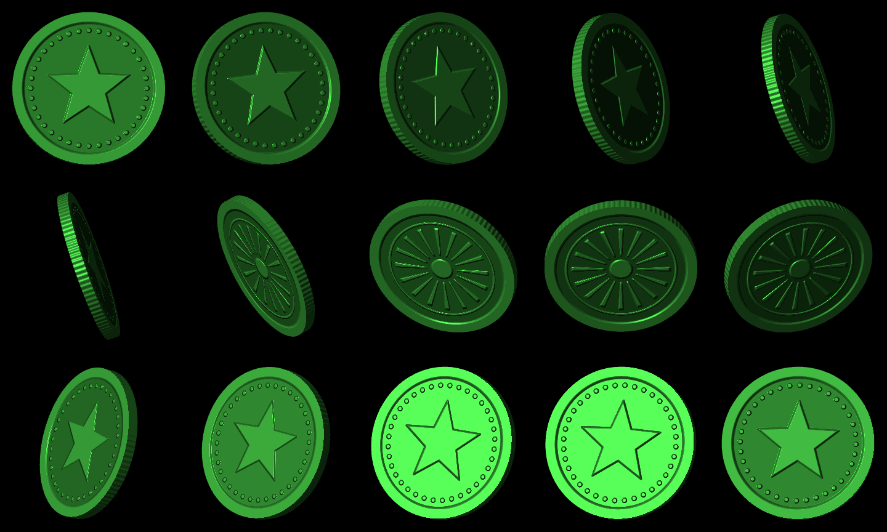

# Coin demo



The coin demo tests whether the engine can play animation.
It draws a 3D coin with a fresh shader on every frame.
Nothing in the demo is a stored image.

## Running it

```sh
npm run dev
evenhub-simulator http://127.0.0.1:47846/
```

The page also opens in a normal browser, where it draws only into the preview canvas.

| Input | Effect |
| --- | --- |
| Tap | Pause or resume. While paused, the engine sends 0 tiles per frame. |
| Swipe up or down | Spin speed, from -2 to 2 turns per second in steps of 0.25. |
| Double-tap | Bayer dither on or off. |
| Long-press | Switch between the large coin (2 tiles) and the small coin (1 tile). |

The right-hand text column shows live statistics: frames per second, draw time, time spent sending, tiles per frame, and PNG kilobytes per frame.

## Page layout

- A native text container at x 0 to 144 holds the title and receives input (`isEventCapture: 1`).
- A native text container at x 432 to 576 shows the statistics. It updates once per second with `textContainerUpgrade`.
- The large coin uses two image tiles, 288×144 each, at (144, 0) and (144, 144).
- The small coin uses one image tile, 288×144, at (144, 72).

Switching layout stops the frame loop, rebuilds the page with `rebuildPageContainer`, and starts a new `Engine`, which sends every tile once.

## How the coin is rendered

`demos/coin/coin.ts` ray-casts a short cylinder for every pixel.

- **Geometry.** The coin is a cylinder with radius 124 pixels and thickness 18 pixels. It leans back 20° and spins about the vertical axis. An orthographic camera looks down at it from 15° above.
- **Intersection.** Each ray is tested against the slab between the two faces and against an infinite cylinder. The ray enters the coin at the later of the two entry points. Whether the slab or the cylinder entry is later tells you if the ray hit a face or the edge.
- **Relief.** Each face has a height field: a rim, a ring of beads and a five-pointed star on the front, and a rim, a ring, a hub and 16 rays on the back. The star uses Inigo Quilez's signed distance function for a five-pointed star. The shader turns the height field into a surface normal with central differences (bump mapping). The back face is mirrored so its design reads correctly.
- **Edge.** The edge normal is perturbed by a sine wave with 90 periods around the coin, which draws the ridges.
- **Lighting.** One light shines from the upper left. Shading is a diffuse term plus two specular lobes with exponents 6 and 40. The 20° lean makes each face swing through the light once per turn, which produces the flash of metal.
- **Anti-aliasing.** Each pixel traces 4 coverage rays in a rotated grid to smooth the silhouette. Shading runs once per pixel, at the first ray that hits, so each pixel costs one shading call instead of four.

## Tests

`test/coin.test.ts` checks the geometry against closed-form results:

- The width of the rendered silhouette matches the width of a tilted cylinder, `2(R·√(1 − aₓ²) + T·|aₓ|)`, within 2 pixels at 8 angles. Here `aₓ` is the x component of the coin's axis.
- The centre pixel shows the front at 0° and the back at 180°. It shows the edge exactly where the face turns away from the camera, at `cos θ = −tan(lean)·tan(pitch)`, about 95.6°.
- No pixel outside `coinBounds` is lit, so the coin never spills into a tile it does not belong to.
- The shader returns the same values on repeated calls, so an unchanged angle sends no tiles.

## Offline renders

These scripts run in Node and write the same 16-level pixels the glasses would receive:

```sh
node scripts/coin-sheet.ts artifacts/coin-sheet.png   # 15 angles in one grayscale image, plus render times
node scripts/coin-frames.ts artifacts/frames 40       # one full turn as 40 PNG frames
```

The README GIF comes from `coin-frames.ts`, tinted green and assembled with ffmpeg:

```sh
ffmpeg -framerate 20 -i artifacts/frames/coin-%03d.png \
  -vf "format=rgb24,colorchannelmixer=rr=0.35:gg=1:bb=0.35,split[a][b];[a]palettegen=max_colors=16:reserve_transparent=0[p];[b][p]paletteuse=dither=none" \
  -loop 0 docs/assets/coin.gif
```

## Results so far

On G2 glasses (iPhone, iOS 18.7, SDK 0.0.16), the small coin ran at 1.4 to 2 fps for about 5 minutes.
Drawing a frame on the phone took about 13 to 18 ms. Each image update took 550 to 730 ms, so the link sets the frame rate.
The [link probe](g2-platform.md#measured-on-glasses) explains why: each image update costs about 150 ms plus time for the detail in the image, and the shaded coin has a lot of detail.

The rest of this section comes from the Even Hub simulator 0.9.5 on a desktop PC.

| Layout | Frame rate | Draw time per frame | Send time per tile | PNG bytes per frame |
| --- | --- | --- | --- | --- |
| Large, 2 tiles | 19 to 29 fps across runs | about 19 ms | 4 to 9 ms | about 41 KB |
| Small, 1 tile | 30 fps (the cap) | 5 to 6 ms | 4 to 9 ms | about 21 KB |

Draw time includes painting the browser preview canvas, which a glasses-only build would skip.

Moving content that spans two tiles can tear, because the tiles update one after another.
To check, we matched the top and bottom halves of 50 burst screenshots of the large coin against 360 offline renders.
Most screenshots matched a single angle.
A few matched best with the two halves about one frame apart (6 to 9°), which is what tearing looks like.
The match is noisy when the coin is nearly edge-on, so treat this as likely rather than proven.
The small coin cannot tear, because each frame is a single update.

The simulator applies neither the 100 ms pacing nor the Bluetooth cost, so its frame rates say nothing about speed on the glasses.
